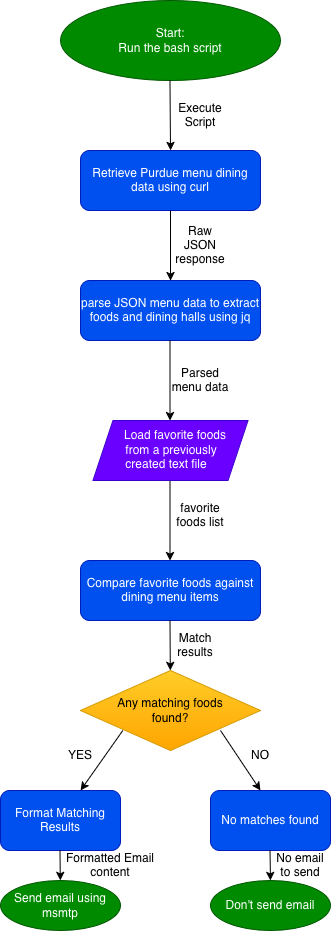

# Purdue Dining Alert

A Bash script that checks Purdue dining hall menus for your favorite foods and sends an email notification when a match is found.

## The Problem

A problem I have as a Purdue student is manually checking all the dining halls' menus on the Purdue Menus app and looking for meals I like. It's repetitive and time-consuming and can make it difficult to locate where my favorite foods are being served.

## How It Works

The Bash script retrieves Purdue dining hall menu data using curl.

It uses jq to parse the JSON data and extract food names and dining hall locations.

It reads a list of favorite foods from favorites.txt.

It compares the favorite foods against the dining hall menu items using grep.

If matching foods are found, it sends an email notification using msmtp. Otherwise, no email is sent.




## Tech Stack

- **Language:** Bash / Java / etc.
- **Libraries:** jq for parsing JSON and grep for searching menu items.
- **External tools:** curl for retrieving dining menu data, msmtp for sending emails, and Purdue Dining's menu API as the data source.

## Setup

1. Clone the GitHub repository.
2. Install `curl`, `jq`, and `msmtp`.
3. Add your favorite foods to `favorites.txt`, one food per line.
4. Configure `msmtp` with your email account.
5. Run the Bash script.

```bash
chmod +x dining_alert.sh
./dining_alert.sh
```

## Usage

Edit `favorites.txt` to include the foods you want to monitor.

Example:

```text
Pizza
Chicken Parmesan
Mac and Cheese
```

Run the script using:
```bash
./dining_alert.sh
```

## Roadmap

- [ ] Retrieve Purdue dining hall menu data using `curl`.
- [ ] Parse the menu data using `jq`.
- [ ] Compare menu items against foods in `favorites.txt`.
- [ ] Send email notifications using `msmtp`.
- [ ] Run the script on a cloud server so it works even when my computer is off.
- [ ] Use `cron` to automatically run the script daily.

## Author

Ivan Ivanov
Github: https://github.com/Dqnkzyy 
